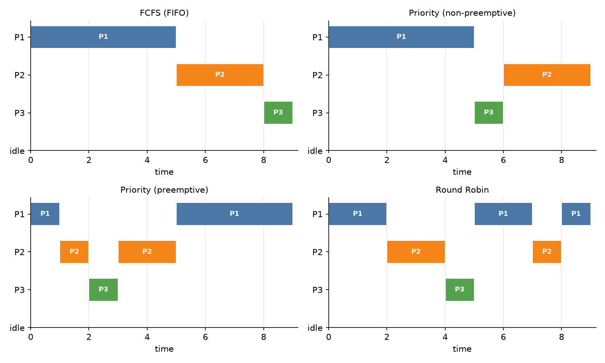
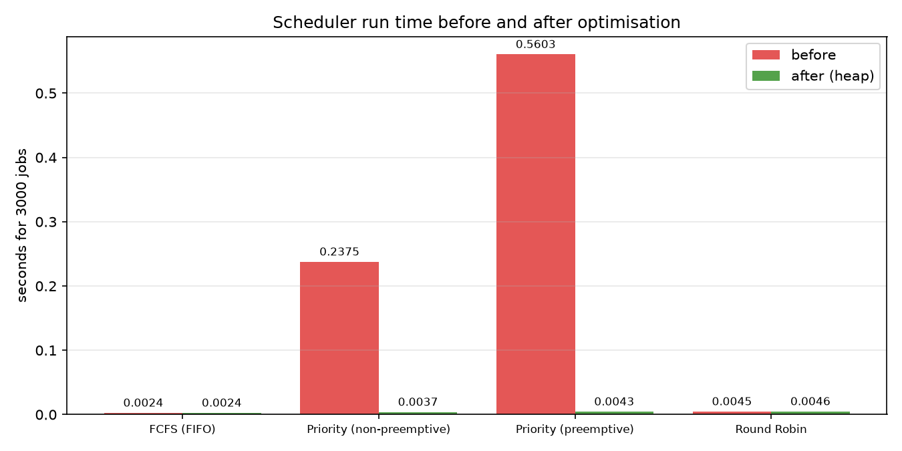

# CPU / Process Monitor and Job Scheduler

Software Systems Lab project, IIT Dharwad.

A desktop app (Python + Tkinter) that watches the processes running on your computer and also works as a CPU job scheduler.

- **Process monitor**: live table of all processes (PID, PPID, user, state, CPU %, memory, threads), with search, sorting and Terminate / Kill / Suspend / Resume buttons.
- **Process tree**: the Unix parent -> child hierarchy, plus the ancestry of any process.
- **System graphs**: live CPU and memory graphs, per-core usage, load average, process states.
- **Scheduler simulation**: FCFS (FIFO), Priority (non-preemptive and preemptive) and Round Robin, with an animated Gantt chart, statistics, a comparison window and CSV export.
- **Real process scheduler**: starts real child processes and schedules them with `SIGSTOP` / `SIGCONT` from a separate thread.



## Team

| Member | Roll no. | Main part |
|---|---|---|
| Rahul Ahirwar | CS25BT011 | Design and all the code: scheduling algorithms and statistics, process monitor and tree, real process scheduler (threads, signals), Tkinter GUI and plots, bash scripts, tests, profiling, Git |
| Ganesh | CS25BT010 |ATEX report, Beamer slides and the presentation |


## Topics covered

| Course topic | Where |
|---|---|
| Unix process hierarchy | `procsched/monitor.py` (tree from PPID), `procsched/executor.py` (fork/exec, signals) |
| Process monitoring | `procsched/monitor.py` (psutil, process states, system stats) |
| Threads | `MonitorThread` and `RealScheduler`, sharing data with a `Lock` and a `Queue` |
| Python | the whole project, `unittest`, `cProfile` |
| GUI | `procsched/gui.py` (Tkinter, 5 tabs) |
| Plotting | matplotlib charts inside the GUI, `docs/make_figures.py` |
| Bash | `scripts/` (7 scripts) |
| Profiling | `profiling/profile_app.py`, `scripts/profile.sh` |
| Git | commit history (`git log --oneline`) |
| LaTeX | `report/report.tex`, `presentation/slides.tex` (Beamer) |

## Installation

Requirements: macOS or Linux, Python 3.9+ **with Tk 8.6 or newer**, and git.

> On macOS, Apple's built-in `/usr/bin/python3` has Tk 8.5, which freezes on new macOS versions.
> Install Homebrew's Python instead: `brew install python-tk@3.12`.
> On Ubuntu: `sudo apt install python3 python3-venv python3-tk`.

```bash
git clone <repo-url>
cd "SSL Project"
./scripts/setup.sh        # creates .venv and installs psutil + matplotlib
```

`setup.sh` finds a Python with a working Tk, makes the virtual environment and installs `requirements.txt`.

## Compilation

Python does not need compiling. The only things that get compiled are the LaTeX documents:

```bash
./scripts/build_docs.sh   # -> report/report.pdf and presentation/slides.pdf
```

The script uses `latexmk`, `pdflatex` or `tectonic`, whichever is installed (`brew install tectonic` is the smallest option on macOS). You can also upload the `.tex` files and the `docs/` folder to Overleaf.

## Usage

### GUI

```bash
./scripts/run.sh
```

| Tab | What to do |
|---|---|
| Processes | Click a column heading to sort, type in Search, select a row and use Suspend / Resume / Terminate / Kill |
| Process Tree | Expand nodes, use "Find this app", click a process to see its ancestry |
| System Monitor | Watch the live CPU / memory graphs |
| Scheduler (Simulation) | Add jobs (or press Example / Random), choose an algorithm and quantum, press Run. "Compare all" shows all algorithms side by side |
| Real Process Scheduler | Choose an algorithm, press Start. The log shows every fork, SIGSTOP and SIGCONT |

### Command line

```bash
./scripts/run.sh schedule --algo all                                   # compare all algorithms
./scripts/run.sh schedule --algo rr -q 2 --jobs "P1:0:5:3,P2:1:3:2,P3:2:1:1"
./scripts/run.sh schedule --algo priority-p --random 6 --seed 7
./scripts/run.sh monitor --top 10                                      # top processes
./scripts/run.sh tree --pid 1 --depth 2                                # process tree
./scripts/run.sh real --algo rr -q 0.5                                 # real processes
```

Job format: `id:arrival:burst[:priority]`. A smaller priority number means more important.
Algorithm names: `fcfs`, `fifo`, `priority` (non-preemptive), `priority-p` (preemptive), `rr`, `all`.

### Bash scripts

| Script | What it does |
|---|---|
| `scripts/setup.sh` | Finds a good Python, creates `.venv`, installs libraries |
| `scripts/run.sh` | Starts the GUI, or the CLI if you pass arguments |
| `scripts/run_tests.sh` | Runs all unit tests and CLI checks, saves `tests/test_log.txt` |
| `scripts/profile.sh [jobs]` | Profiles with cProfile and prints before/after timings and peak memory |
| `scripts/build_docs.sh` | Draws the charts and compiles the report and slides |
| `scripts/stress.sh [workers] [secs]` | Starts CPU-heavy processes to watch in the monitor (stopped automatically) |
| `scripts/demo.sh` | Step-by-step terminal demo for the presentation |

## Testing

```bash
./scripts/run_tests.sh
```

There are 26 unit tests (`tests/`) plus 6 command-line checks. They cover:
- every algorithm against examples solved by hand
- the optimised (heap) priority code against a simple reference on 300 random inputs
- edge cases: idle CPU, a single job, equal priorities, quantum 1, convoy effect, starvation, bad input
- the process monitor and tree
- real processes with FCFS and Round Robin
- the CLI and its exit codes

## Profiling

```bash
./scripts/profile.sh 3000
```

We used **cProfile** + **pstats** (and `/usr/bin/time -l` for memory). Results are saved in `profiling/results/` (`*_before.txt` and `*_after.txt`).

| Bottleneck found | Fix | Before | After |
|---|---|---|---|
| Priority scheduling was O(n^2): 6.2 million calls to `min()`'s key function | keep ready jobs in a heap (`heapq`) | 0.2375 s (non-preemptive), 0.5603 s (preemptive) | 0.0036 s, 0.0042 s |
| `pwd.getpwuid` was about 25% of each process snapshot | cache uid -> user name | 0.0244 s | 0.0186 s |

(3000 random jobs, Apple M-series Mac. Your numbers will differ a little.)



## Worked example

| Job | Arrival | Burst | Priority |
|---|---|---|---|
| P1 | 0 | 5 | 3 |
| P2 | 1 | 3 | 2 |
| P3 | 2 | 1 | 1 |

| Algorithm | Avg waiting | Avg turnaround | Avg response | Context switches |
|---|---|---|---|---|
| FCFS | 3.33 | 6.33 | 3.33 | 2 |
| Priority (non-preemptive) | 2.67 | 5.67 | 2.67 | 2 |
| Priority (preemptive) | 1.67 | 4.67 | 0.00 | 4 |
| Round Robin (q=2) | 3.33 | 6.33 | 1.00 | 5 |

Formulas: Turnaround = Finish - Arrival, Waiting = Turnaround - Burst, Response = First run - Arrival, Throughput = jobs / total time, CPU utilisation = busy time / total time.

## Project structure

```
main.py                   entry point (GUI by default, --cli for terminal mode)
procsched/
  scheduler.py            FCFS, Priority, Round Robin + statistics
  monitor.py              psutil snapshots, process tree, signals, MonitorThread
  executor.py             RealScheduler thread (real processes + SIGSTOP/SIGCONT)
  gui.py                  Tkinter GUI with matplotlib charts
  cli.py                  command line interface
tests/                    unit tests
profiling/                cProfile script and saved results
scripts/                  bash automation
docs/                     figures, step-by-step guide, demo script
report/                   LaTeX report (report.tex -> report.pdf)
presentation/             Beamer slides (slides.tex -> slides.pdf)
```

More documentation:
- [docs/GUIDE.md](docs/GUIDE.md): building this project step by step from zero
- [docs/DEMO.md](docs/DEMO.md): plan for the 5-minute demo

## Declaration of AI use

As allowed by the course AI policy, we used an AI assistant (Claude, by Anthropic) for this project. We used it to plan the project, explain the concepts, and write first versions of the code, bash scripts, tests, report and slides. We read, ran and tested all of it, checked the scheduling results by hand, and each member can explain the parts listed under their name.
